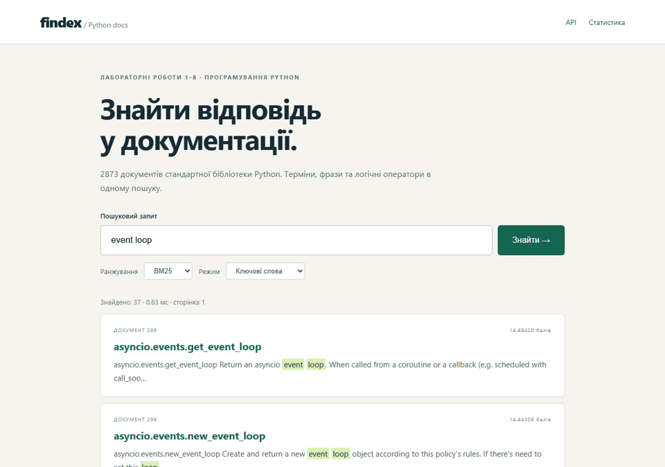
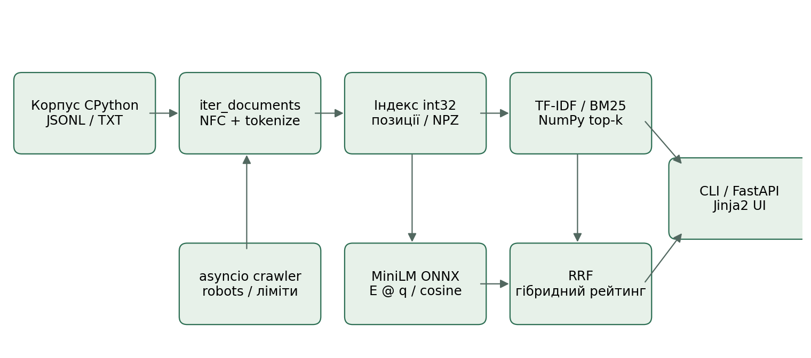

# findex

Пошук у 2873 документах стандартної бібліотеки Python: CLI, вебінтерфейс, BM25 та семантичний MiniLM.

**Локальна адреса:** http://127.0.0.1:8010/ під час поточного запуску. Публічна адреса не створювалася: користувач заборонив публікацію.



- Корпус: 2873 документів, 190517 токенів, 1,513,665 байтів.
- p95 локального NumPy-сервісу: 104.464 мс, oha, 1000 запитів / concurrency 50.
- Найбільше виміряне прискорення скорера: 9.46×; на рідкому терміні NumPy повільніший.


## Встановлення та запуск

Python 3.13 рекомендовано; метадані підтримують Python 3.12–3.13, перевірено 3.13.18. Команди виконуються з Project/.

```powershell
uv sync --frozen --all-extras
uv run python scripts/prepare_corpus.py
uv run findex index data/stdlib.jsonl --positions --out data/index.npz
uv run findex search data/index.npz '"event loop" OR asyncio' --k 5
uv run findex serve --port 8010
```

У комплекті вже є корпус, індекс, модель та ембеддинги; повторна підготовка не потрібна.
На цій машині готове середовище запускається командою `.\.venv\Scripts\python.exe -m findex --help`.
Середовище .venv не включено в ZIP, бо містить абсолютне посилання на локальний Python.
Архів має portable Runtime та Offline/wheelhouse для автономного встановлення в Windows x64 Python 3.13; див. INSTALL_OFFLINE.md.

```powershell
uv build
uv tool install dist/findex-1.0.0-py3-none-any.whl
findex --help
```

## Команди

```powershell
findex stats data/index.npz
findex -v index data/stdlib.jsonl --positions --workers 4 --executor processes --out data/index.npz
findex -vv search data/index.npz 'python OR asyncio' --scorer bm25 --backend numpy --json
findex search data/index.npz 'event loop' --engine set --backend python
findex crawl http://127.0.0.1:8766/ --max-pages 200 --concurrency 5 --out data/crawl.jsonl
findex index data/crawl.jsonl --positions --out data/crawled.npz
findex embed data/index.npz --model all-MiniLM-L6-v2 --out data/embeddings
findex search data/index.npz 'checksum' --mode semantic
findex search data/index.npz 'decompression' --mode hybrid
findex serve --port 8010 --workers 1
```

Локальне дзеркало для crawl запускається `uv run uvicorn scripts.mirror:app --port 8766`.
Типовий executor=serial: на цьому корпусі процеси не виграли. `-v/-vv` передається перед підкомандою.
`--json` пише лише JSON Lines у stdout, діагностика й прогрес ідуть у stderr.

## HTTP API

- `/search?q=event%20loop&k=5&page=1&scorer=bm25&mode=keyword`
- `/search?q=memoization&mode=semantic` та `mode=hybrid`.
- `/docs/1010` — JSON документа, `/doc/1010` — його сторінка.
- `/stats`, `/health`, `/docs` — статистика, health check та OpenAPI.

Параметри перевіряє Pydantic; неправильні межі дають 422, помилка синтаксису запиту — 400,
невідомий документ — 404, незавантажений індекс — 503. Непередбачений виняток повертає чистий 500 із request_id.
Сервіс читає INDEX_PATH, MODEL_PATH, EMBEDDINGS_PATH, ROUTE_STYLE та BACKEND із середовища.
Основний маршрут — def, FastAPI переносить його в пул потоків; async-варіант лишено лише для контрольного вимірювання.

## Архітектура



## Структура

`src/findex/`: corpus, tokenize, stats, index, boolean, store, query, scoring, search,
parallel, vector, semantic, retrieval, cli; `crawler/` та `web/` — мережеві компоненти.
`tests/` — unit, Hypothesis, TestClient та benchmark; `scripts/` — відтворення корпусу і вимірювань.
`evaluation/` — зафіксовані relevance judgments; `docs/` — таблиці, схеми, профілі, GIF і відео.
`data/` і `models/` ігноруються Git, проте включені до комплекту здачі.

## Тестування

```powershell
uv run pytest --cov=findex
uv run ruff check .
uv run ruff format --check .
uv run pyright
uv run mypy
uv run pytest tests/test_benchmark.py --benchmark-json=bench.json
```

На машині перевірки: 103 pytest-тестів, 0 failures, 0 errors; покриття 86.56%.
Не всі аварійні гілки файлової системи, запуск окремих модульних CLI та інтерактивне відображення
прогресу охоплено unit coverage; CLI додатково перевірено справжніми командами й установленням wheel.
CI підготовлено у `.github/workflows/ci.yml`; зовнішній GitHub Actions не запускався і зелений статус не стверджується.

## Корпус і токенізатор

Справжні docstring CPython 3.13.18, ліцензія PSF. Відтворення — scripts/prepare_corpus.py;
походження та SHA256 — docs/measurements/corpus_manifest.json. NFC → casefold → re.finditer.
Цифри зберігаються; дефіс та underscore розділяють; внутрішні апострофи лишаються й уніфікуються.
Некоректний UTF-8 читається з replacement, хибні JSONL-записи пропускаються з діагностикою.

## Вимірювання лабораторних 1–8

Машина: AMD Ryzen 7 7800X3D 8-Core Processor, 16 логічних CPU; Windows-11-10.0.26300-SP0.
Показники RSS — спостережений пік батька, не сумарна пам’ять усіх процесів.
Повні таблиці нижче, методика й первинні JSON — [docs/MEASUREMENTS.md](docs/MEASUREMENTS.md).

# Вимірювання лабораторних робіт 1–8

Усі числа нижче походять із файлів Tests/. Результати залежать від машини й методики; це не прогноз продуктивності.

## Лабораторна 1. Ітератори, генератори та корпус документів

Потік iter_documents відкриває один файл або один запис JSONL за раз. Counter є накопичувачем результату; його пам’ять зростає зі словником, а не з усім корпусом. Жадібна версія додатково утримує всі тексти та списки токенів. Обидва шляхи дали однакову статистику.

| Версія | Документи | Пік, байтів | Час, с |
|---|---|---|---|
| Лінива | 2873 | 1635543 | 0.267087 |
| Жадібна | 2873 | 12445233 | 0.270493 |


## Лабораторна 2. Інвертований індекс: словники, хешування та пам’ять

Постінги будуються за один прохід і сортуються за doc_id. Slots усуває словник атрибутів кожного об’єкта; array зберігає сирі числа без окремих об’єктів int. На частих термінах set виграв у merge; на рідких списках наклад set більший. Pickle придатний тільки для власних довірених індексів; JSON не виконує код.

| Подання | Пік, байтів | Файл, байтів | Load, с |
|---|---|---|---|
| plain | 13492326 | 2658739 | 0.049090 |
| slots | 8853847 | 1965289 | 0.174246 |
| array | 3741528 | 1321788 | 0.006163 |


| Формат | Розмір, байтів | Save, с | Load, с |
|---|---|---|---|
| .json | 7274123 | 0.268088 | 0.222553 |
| .bin | 3966776 | 0.232745 | 0.245044 |


| Терміни | Рушій | Медіана, мс |
|---|---|---|
| the / a | merge | 0.427450 |
| the / a | set | 0.132050 |
| zscore / zz | merge | 0.000300 |
| zscore / zz | set | 0.000500 |


## Лабораторна 3. Ранжування і модель об’єктів: протоколи, декоратори та мова запитів

Парсер будує дерево з пріоритетом NOT > AND > OR; суміжні терміни означають AND. Фраза перевіряється за суміжними позиціями. BM25 нормалізує довжину й насичує TF, а TF-IDF використовує логарифмічний TF. Усі результати впорядковуються детерміновано за балом та doc_id. P@5 є розвідувальною оцінкою з неповними AI-судженнями. Три sanity-check додатково обчислено на документах повного корпусу. Для насичення використано реальний документ з TF≥20 та незмінними IDF/довжиною, обмежуючи враховані входження до 1, 2, 19, 20; це контрольний розрахунок скорера, а не зміна корпусу.

| Запит | TF-IDF P@5 | BM25 P@5 |
|---|---|---|
| event loop | 0.20 | 0.20 |
| json | 0.80 | 0.20 |
| regular expression | 0.20 | 0.20 |
| thread | 0.40 | 0.20 |
| queue | 0.20 | 0.40 |
| cache | 0.20 | 0.20 |
| gzip file | 0.40 | 0.40 |
| socket | 0.40 | 0.00 |
| url parse | 0.60 | 0.20 |
| file digest | 0.20 | 0.20 |


| Перевірка на повному корпусі | Перша оцінка | Друга оцінка |
|---|---|---|
| Рідкий проти частого (bm25) | 10.504558 | 0.315547 |
| Рідкий проти частого (tfidf) | 9.791759 | 4.142448 |
| Приріст 2-го / 20-го входження | 0.044027 | 0.002791 |
| Короткий (17) / довгий (862) | 1.833573 | 0.190637 |


## Лабораторна 4. Типи, тестування, пакування і CLI

Публічні функції типізовано; рушії мають Literal у внутрішньому API та Enum на межі Typer. Протокол Scorer не потребує успадкування. JSON Lines надходять лише у stdout; діагностика — stderr. Зібраний wheel перевірено встановленням через uv tool в окреме середовище. Віддалений статус CI не видається за перевірений.

| Перевірка | Результат |
|---|---|
| pytest на етапі 4 | 58 passed |
| Покриття на етапі 4 | 80% |
| pyright strict | 0 errors |
| mypy strict | 0 errors |
| ruff | check / format пройдено |
| Wheel | findex-0.4.0-py3-none-any.whl; встановлено uv tool у чисте середовище |
| Зовнішній CI / GitHub Release | Не запускалися / не публікувалися |


## Лабораторна 5. Конкурентність і GIL: потоки, процеси та паралельна індексація

Кожна клітинка містить медіану щонайменше трьох запусків на повному корпусі. CPU для процесів включає батьківський процес та виміряний CPU воркерів; RSS стосується лише батька. У 3.13t RSS відстежував окремий звичайний Python, тому вільнопотоковий процес не імпортував розширення, здатні ввімкнути GIL. Потоки 3.13t перевірено з sys._is_gil_enabled() == False. У рядках serial N означає число послідовно оброблених частин, а не одночасні потоки.

| Рушій | N | Wall, с | CPU, с | RSS, МБ | Merge, с | Speedup |
|---|---|---|---|---|---|---|
| serial | 1 | 0.2327 | 0.2344 | 50.50 | 0.0174 | 1.00× |
| serial | 2 | 0.2404 | 0.2188 | 51.31 | 0.0247 | 0.97× |
| serial | 4 | 0.2607 | 0.2500 | 51.61 | 0.0319 | 0.89× |
| serial | 8 | 0.3452 | 0.2656 | 52.48 | 0.0371 | 0.67× |
| serial | 16 | 0.3991 | 0.2969 | 53.39 | 0.0589 | 0.58× |
| threads | 1 | 0.2242 | 0.2344 | 54.24 | 0.0172 | 1.04× |
| threads | 2 | 0.2367 | 0.2344 | 54.15 | 0.0231 | 0.98× |
| threads | 4 | 0.2447 | 0.2344 | 54.10 | 0.0283 | 0.95× |
| threads | 8 | 0.2662 | 0.2656 | 54.19 | 0.0342 | 0.87× |
| threads | 16 | 0.2750 | 0.2812 | 54.66 | 0.0381 | 0.85× |
| processes | 1 | 0.6909 | 0.3906 | 72.68 | 0.0175 | 0.34× |
| processes | 2 | 0.5242 | 0.3750 | 71.31 | 0.0249 | 0.44× |
| processes | 4 | 0.4454 | 0.3906 | 70.09 | 0.0315 | 0.52× |
| processes | 8 | 0.4473 | 0.4375 | 69.53 | 0.0401 | 0.52× |
| processes | 16 | 0.5224 | 0.5625 | 68.34 | 0.0469 | 0.45× |
| threads 3.13t | 1 | 0.2896 | 0.2969 | 50.48 | 0.0201 | 0.80× |
| threads 3.13t | 2 | 0.2297 | 0.3125 | 52.54 | 0.0378 | 1.01× |
| threads 3.13t | 4 | 0.2043 | 0.2969 | 54.05 | 0.0496 | 1.14× |
| threads 3.13t | 8 | 0.2188 | 0.4531 | 57.38 | 0.0574 | 1.06× |
| threads 3.13t | 16 | 0.3166 | 0.9688 | 63.17 | 0.0714 | 0.74× |


## Лабораторна 6. Асинхронний краулер: asyncio

Джерело — власне локальне дзеркало scripts/mirror.py, а не сторонній сайт. Модель I/O явно містить затримку 15 мс, per_host=20 та мінімальну паузу 2 мс. Усі три конфігурації збирали по 200 сторінок з тієї самої початкової адреси. HTTP 429 із Retry-After=0 повторено успішно; це видно в crawl.log. RSS семплувався після сторінок. Concurrency=5 виявилася швидшою за 20; універсального виграшу 20 не стверджується.

| Concurrency | Сторінки | Wall, с | Стор./с | Помилки | RSS, МБ |
|---|---|---|---|---|---|
| 1 | 200 | 4.0159 | 49.80 | 0 | 51.54 |
| 5 | 200 | 1.0219 | 195.72 | 0 | 52.53 |
| 20 | 200 | 1.8156 | 110.16 | 0 | 53.31 |


## Лабораторна 7. Вебпошук: FastAPI, Pydantic та вебінтерфейс

oha 1.16.0 надсилав по 1000 справжніх HTTP-запитів з concurrency=50. Окремий дослід надсилав 20 запитів одночасно через httpx. Для oha SSL_CERT_FILE указував на certifi, оскільки читання системного сховища сертифікатів було недоступне; налаштування Windows не змінювалися. Чотири процеси розділяють GIL, але кожен завантажує власний індекс.

| Конфігурація | RPS | p50, мс | p95, мс | p99, мс | 20 запитів, с |
|---|---|---|---|---|---|
| local-sync-1 | 533.22 | 91.945 | 115.244 | 201.575 | 0.058495 |
| local-async-1 | 481.50 | 101.303 | 121.269 | 234.076 | 0.051180 |
| local-sync-4 | 1817.43 | 25.146 | 35.627 | 43.28 | 0.034062 |


## Лабораторна 8. Профілювання, NumPy та семантичний пошук

Вимірювання — медіани 100 прогрітих запусків без побудови індексу й без снипетів. NumPy виграє на довгих списках, але програє на рідкому терміні через наклад виклику масивних операцій. Збережений NPZ містить лише числові масиви й JSON; allow_pickle=False. MiniLM є реальною локальною ONNX-моделлю, а не заміною на випадкові вектори. Вектори фрагментів L2-нормовано; оцінка документа — найкращий фрагмент; RRF зливає ранги з константою 60.

| Скорер / запит | Збігів | Python, мс | NumPy, мс | Speedup |
|---|---|---|---|---|
| bm25 / the | 2495 | 2.369900 | 0.250550 | 9.46× |
| bm25 / zscore | 1 | 0.007100 | 0.018800 | 0.38× |
| bm25 / the file return | 111 | 0.315550 | 0.184650 | 1.71× |
| tfidf / the | 2495 | 1.760650 | 0.259500 | 6.78× |
| tfidf / zscore | 1 | 0.006100 | 0.016000 | 0.38× |
| tfidf / the file return | 111 | 0.241050 | 0.170000 | 1.42× |


| Запит | Keyword P@5 | Semantic P@5 | Hybrid P@5 |
|---|---|---|---|
| event loop | 0.20 | 0.00 | 0.20 |
| json | 0.20 | 0.20 | 0.20 |
| regular expression | 0.20 | 0.20 | 0.20 |
| thread | 0.20 | 0.20 | 0.20 |
| queue | 0.40 | 0.00 | 0.20 |
| cache | 0.20 | 0.20 | 0.20 |
| gzip file | 0.40 | 0.40 | 0.40 |
| socket | 0.00 | 0.00 | 0.00 |
| url parse | 0.20 | 0.40 | 0.20 |
| file digest | 0.20 | 0.20 | 0.20 |
| memoization * | 0.00 | 0.00 | 0.00 |
| decompression * | 0.00 | 0.00 | 0.00 |
| checksum * | 0.00 | 0.00 | 0.00 |
| deserialization * | 0.00 | 0.20 | 0.20 |
| FIFO * | 0.00 | 0.00 | 0.00 |


Зірочкою позначено п’ять перефразованих запитів. Їхній токеновий перетин із цільовими документами дорівнює нулю.

| Група | Keyword | Semantic | Hybrid |
|---|---|---|---|
| all15 | 0.147 | 0.133 | 0.147 |
| original10 | 0.220 | 0.180 | 0.200 |
| paraphrase5 | 0.000 | 0.040 | 0.040 |


Невелика вибірка та неповні судження не дають підстав оголошувати універсального переможця. Для запиту з одним релевантним документом максимальний P@5 становить 0.2. Судження підготував AI-асистент за текстом корпусу, не студент і не незалежна група анотаторів.

## Обмеження та здача

Корпус невеликий; ці прискорення не екстраполюються на гігабайти. MiniLM — англомовна
квантизована модель; якість українського пошуку не вимірювалася. P@5 має неповні AI-судження
та малу вибірку. Keyword-режим зберігає Boolean AND, тому природномовні перефразування можуть
не мати жодного буквального збігу. Семантичний режим не інтерпретує Boolean-оператори.

Pickle завантажується тільки з довірених локальних файлів. NPZ/NPY відкриваються з allow_pickle=False.
Краулер тестувався на власному локальному дзеркалі; його User-Agent містить локальну контактну
адресу. Для іншого сайту потрібен реальний контакт оператора та дозвіл цього сайту.
У вимірюванні concurrency 20 не перемогла 5 — це відображено без виправлення цифр.

Dockerfile та render.yaml підготовлено; Docker відсутній, складання контейнера не перевірене.
GitHub Release, віддалений CI та публічне розгортання не виконані за прямою вказівкою користувача.
Локальні теги lab-01…lab-08, v0.4.0, v0.7.0, v1.0.0 і Git bundle входять у комплект.
Відео: [docs/demo.webm](docs/demo.webm), GIF: [docs/demo.gif](docs/demo.gif).

Роботу підготовлено з допомогою AI. Локальна історія створена під час цієї сесії, а не за семестр.
Для захисту слід розібрати код та підготувати власні відповіді на Reflection; див. Documentation/DEFENSE.md.
