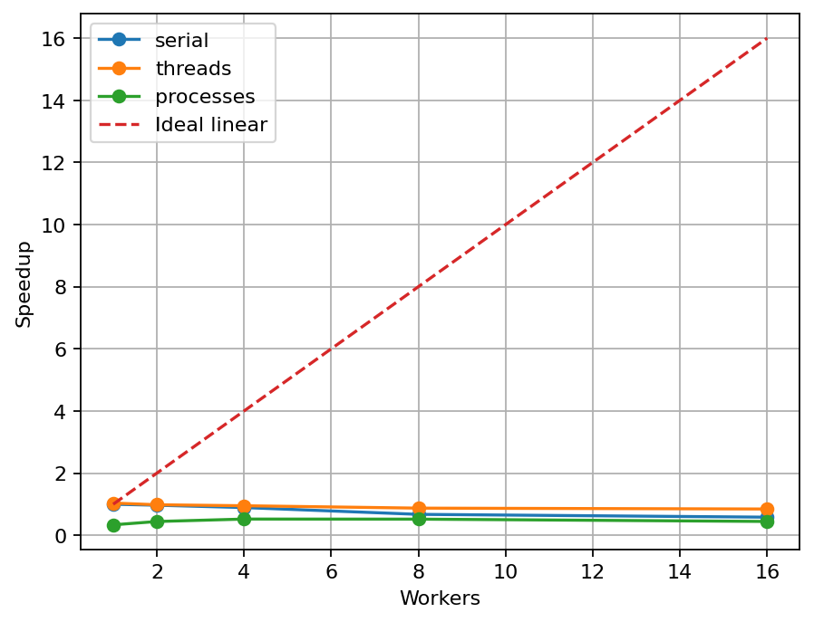

# findex

Навчальна пошукова система над docstring стандартної бібліотеки CPython.
Це єдиний проєкт восьми лабораторних дисципліни «Програмування Python».
Корпус: 2873 справжніх документи, зібрані scripts/prepare_corpus.py з Python 3.13.18, ліцензія PSF.
Дані не включаються в Git; підготовлений корпус міститься у комплекті здачі.

## Лабораторна 1

NFC, casefold, лінивий re.finditer; цифри зберігаються, дефіси і '_' розділяють слова,
внутрішні апострофи зберігаються й уніфікуються. Пошкоджений UTF-8 читається з replacement.

| Версія | Документи | Пік tracemalloc, байтів | Час, с |
|---|---:|---:|---:|
| lazy | 2873 | 1635543 | 0.2670874 |
| eager | 2873 | 12445233 | 0.2704933 |

Обидві версії дали 190517 токенів та 8875 термінів. Жадібна версія утримує одночасно
документи, списки токенів та Counter; лінива — лише поточний документ і Counter.
Ці числа характеризують конкретний запуск; повторні вимірювання можуть відрізнятися.

Відтворення: python scripts/prepare_corpus.py; python -m findex.stats data/stdlib.jsonl.

## Лабораторна 2

Три подання постінгів на одному корпусі (tracemalloc).

| Подання | Пік, байтів | Файл, байтів | Load, с |
|---|---:|---:|---:|
| plain | 13492326 | 2658739 | 0.049090 |
| slots | 8853847 | 1965289 | 0.174246 |
| array | 3741528 | 1321788 | 0.006163 |

Slots усуває словник атрибутів екземпляра; array зберігає самі числа без окремих Python-об’єктів. Pickle читається лише з довірених локальних файлів: чужий pickle може виконати код. Другий формат JSON не виконує код. Час і розміри обох форматів та merge/set наведено в Tests/lab02_measurements.json комплекту.

## Лабораторна 3

| Запит | TF-IDF P@5 | BM25 P@5 |
|---|---:|---:|
| event loop | 0.20 | 0.20 |
| json | 0.80 | 0.20 |
| regular expression | 0.20 | 0.20 |
| thread | 0.40 | 0.20 |
| queue | 0.20 | 0.40 |
| cache | 0.20 | 0.20 |
| gzip file | 0.40 | 0.40 |
| socket | 0.40 | 0.00 |
| url parse | 0.60 | 0.20 |
| file digest | 0.20 | 0.20 |

Розмітка релевантності неповна; незалежну перевірку людиною не виконано. Оцінки P@5 мають попередній характер. Низький P@5 на запитах із одним релевантним документом обмежений максимумом 0.2. Три sanity-check перевірені тестами: рідкість терміна, насичення BM25, нормалізація довжини. Повторний запит має hit=True у lab03_cache.log.

## Лабораторна 5. Конкурентність і GIL: потоки, процеси та паралельна індексація

Кожна клітинка містить медіану щонайменше трьох запусків на повному корпусі. CPU для процесів включає батьківський процес та виміряний CPU воркерів; RSS стосується лише батька. У 3.13t RSS відстежував окремий звичайний Python, тому вільнопотоковий процес не імпортував розширення, здатні ввімкнути GIL. Потоки 3.13t перевірено з sys._is_gil_enabled() == False.

| Рушій | N | Wall, с | CPU, с | RSS, МБ | Merge, с | Speedup |
|---|---|---|---|---|---|---|
| serial | 1 | 0.2327 | 0.2344 | 50.50 | 0.0174 | 1.00× |
| serial | 2 | 0.2404 | 0.2188 | 51.31 | 0.0247 | 0.97× |
| serial | 4 | 0.2607 | 0.2500 | 51.61 | 0.0319 | 0.89× |
| serial | 8 | 0.3452 | 0.2656 | 52.48 | 0.0371 | 0.67× |
| serial | 16 | 0.3991 | 0.2969 | 53.39 | 0.0589 | 0.58× |
| threads | 1 | 0.2242 | 0.2344 | 54.24 | 0.0172 | 1.04× |
| threads | 2 | 0.2367 | 0.2344 | 54.15 | 0.0231 | 0.98× |
| threads | 4 | 0.2447 | 0.2344 | 54.10 | 0.0283 | 0.95× |
| threads | 8 | 0.2662 | 0.2656 | 54.19 | 0.0342 | 0.87× |
| threads | 16 | 0.2750 | 0.2812 | 54.66 | 0.0381 | 0.85× |
| processes | 1 | 0.6909 | 0.3906 | 72.68 | 0.0175 | 0.34× |
| processes | 2 | 0.5242 | 0.3750 | 71.31 | 0.0249 | 0.44× |
| processes | 4 | 0.4454 | 0.3906 | 70.09 | 0.0315 | 0.52× |
| processes | 8 | 0.4473 | 0.4375 | 69.53 | 0.0401 | 0.52× |
| processes | 16 | 0.5224 | 0.5625 | 68.34 | 0.0469 | 0.45× |
| threads 3.13t | 1 | 0.2896 | 0.2969 | 50.48 | 0.0201 | 0.80× |
| threads 3.13t | 2 | 0.2297 | 0.3125 | 52.54 | 0.0378 | 1.01× |
| threads 3.13t | 4 | 0.2043 | 0.2969 | 54.05 | 0.0496 | 1.14× |
| threads 3.13t | 8 | 0.2188 | 0.4531 | 57.38 | 0.0574 | 1.06× |
| threads 3.13t | 16 | 0.3166 | 0.9688 | 63.17 | 0.0714 | 0.74× |

Детальний аналіз GIL — docs/GIL.md.

## Лабораторна робота №5: запуск і захист

**Тема:** Конкурентність, процеси та GIL.

**Мета:** Порівняти серійне, потокове та процесне індексування, зокрема CPython без GIL.

Відокремлено build_partial і merge, додано три executor та унікальні діапазони doc_id. Порівняно wall/CPU/RSS/merge для 1, 2, 4, 8 та всіх workers і повторено потоки на 3.13t.

[Команди, результати та висновок](docs/LAB_05.md) · [Reflection](docs/DEFENSE.md).
